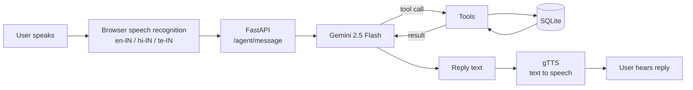

# Multilingual Voice Appointment Agent

A voice-based AI receptionist that books doctor appointments in **English, Hindi and Telugu**.

You speak to it, it understands your request, checks which doctors and time slots are free, books the appointment, and **talks back to you in your own language**.

Built with **Gemini 2.5 Flash function calling**, **FastAPI** and **SQLite**.

---

## Features

- **Voice in, voice out:** speak your request; the agent replies with speech.
- **3 languages:** English, Hindi (हिंदी) and Telugu (తెలుగు). Replies stay fully in the chosen language.
- **LLM tool calling:** the model decides when to look up doctors, check a slot or book an appointment.
- **No double booking:** the database blocks two bookings for the same doctor at the same time.
- **Separate conversations:** each user gets their own chat session and history.
- **Clean speech output:** markdown symbols and bracketed translations are removed before the reply is spoken.

---

## How it works



1. The browser turns the user's speech into text in the selected language.
2. FastAPI sends the text to Gemini along with the 3 tools it can use.
3. If Gemini asks for a tool, the backend runs it on the SQLite database and returns the result. This repeats until Gemini gives a final answer.
4. The answer is cleaned, turned into speech with gTTS, and sent back as text plus audio.

### Tools available to the agent

| Tool | What it does |
|---|---|
| `list_doctors` | Returns all doctors and their specialties |
| `check_slot` | Checks whether a doctor is free at a given time |
| `book_appointment` | Books the slot; returns `conflict` if it is already taken |

---

## Tech stack

| Part | Tool |
|---|---|
| LLM | Google Gemini 2.5 Flash (`google-genai`) |
| Backend | FastAPI, Uvicorn |
| Database | SQLite |
| Speech to text | Web Speech API (in the browser) |
| Text to speech | gTTS |
| Frontend | HTML, Tailwind CSS, JavaScript |

---

## Project structure

```
appointment-agent/
├── app.py            # FastAPI backend, agent loop, tools, text-to-speech
├── frontend.html     # Voice chat interface
├── requirements.txt  # Python dependencies
├── .env.example      # Template for your API key
└── .gitignore
```

The SQLite database (`appointments_poc.db`) is created automatically on first run, with two sample doctors.

---

## Run it locally

**1. Clone the repo**
```bash
git clone https://github.com/<your-username>/appointment-agent.git
cd appointment-agent
```

**2. Create a virtual environment and install dependencies**
```bash
python -m venv venv
# Windows
venv\Scripts\activate
# macOS / Linux
source venv/bin/activate

pip install -r requirements.txt
```

**3. Add your Gemini API key**

Copy `.env.example` to `.env` and paste your key (free from [Google AI Studio](https://aistudio.google.com/apikey)):
```
GEMINI_API_KEY=your_key_here
```

**4. Start the server**
```bash
python app.py
```

**5. Open the app**

Go to **http://127.0.0.1:8000** in **Chrome or Edge** (needed for voice input), pick a language and tap the microphone.

---

## API endpoints

| Method | Endpoint | Purpose |
|---|---|---|
| GET | `/` | Serves the voice chat page |
| POST | `/agent/new_session` | Starts a new conversation, returns `session_id` |
| POST | `/agent/message` | Sends a message; returns reply text and base64 MP3 audio |

Example request for `/agent/message`:
```json
{
  "session_id": "your-session-id",
  "text": "I want to see a cardiologist tomorrow at 2 pm",
  "language_code": "en-IN"
}
```

---

## Known limitations and roadmap

This is a proof of concept. Planned improvements:

- [ ] Convert spoken times ("tomorrow 2 pm") into a standard date-time before saving, so the same slot always matches
- [ ] Ask the user to confirm before booking
- [ ] Add cancel and reschedule tools
- [ ] Add a test suite and an evaluation set of scripted conversations
- [ ] Store sessions in a database instead of memory
- [ ] Add a Dockerfile

---

## Notes

- Never commit your `.env` file. It is already listed in `.gitignore`.
- "City Hospital" and the doctors are sample data for the demo.
